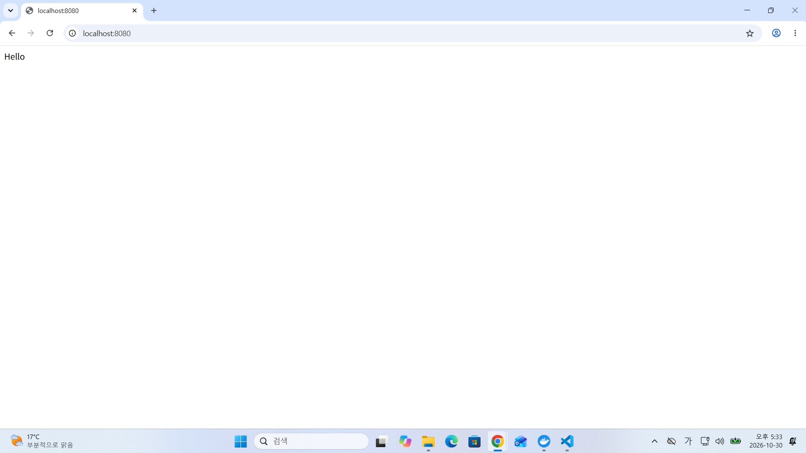
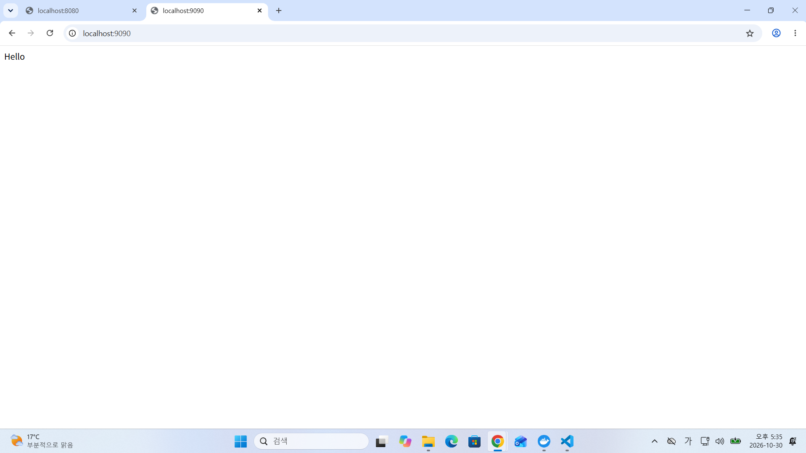

<<<<<<< HEAD
# 1. 프로젝트 개요
본 프로젝트는 개발 워크스테이션 구축 미션의 일환으로, 리눅스 터미널 CLI 기반의 기본 조작, 파일 및 디렉토리 권한 변경, 그리고 Docker 환경 구축 및 관리를 실습하고 검증한 기술 문서입니다.

---

# 2. 실행 환경
- OS: Windows 11 (PowerShell)
- Shell: PowerShell
- Editor: Visual Studio Code
- Git: Installed
- Docker: 29.9.2 (Installed)

---

# 3. 수행 항목 체크리스트
- [x] 터미널 기본 조작 및 폴더 구성
- [x] 권한 변경 실습 (파일 및 디렉토리)
- [x] Docker 설치/점검
- [x] hello-world 실행
- [x] Dockerfile 빌드/실행
- [x] 포트 매핑 접속 (2회)
- [x] 바인드 마운트 반영
- [x] 볼륨 영속성 검증
- [x] Git 설정 + VSCode GitHub 연동

---

# 4. 터미널 조작 및 권한 실습 로그

### 4.1. 위치 확인 및 폴더 생성
현재 위치를 확인(`pwd`)하고, 작업용 디렉토리 `practice`를 생성(`mkdir`) 후 이동(`cd`)했습니다.

```powershell
PS C:\Users\User> pwd

Path
----
C:\Users\User

PS C:\Users\User> mkdir practice
PS C:\Users\User> cd practice
PS C:\Users\User\practice>

PS C:\Users\User\practice> New-Item test.txt -ItemType File

    디렉터리: C:\Users\User\practice

Mode                LastWriteTime         Length Name
----                -------------         ------ ----
-a----       2026-10-30  오후 4:31              0 test.txt

PS C:\Users\User\practice> ls

    디렉터리: C:\Users\User\practice

Mode                LastWriteTime         Length Name
----                -------------         ------ ----
-a----       2026-10-30  오후 4:31              0 test.txt

PS C:\Users\User\practice> icacls test.txt
test.txt NT AUTHORITY\SYSTEM:(I)(F)
         BUILTIN\Administrators:(I)(F)
         4F-73\User:(I)(F)

1 파일을 처리했으며 0 파일은 처리하지 못했습니다.

PS C:\Users\User\practice> icacls test.txt /deny "User:(W)"
처리된 파일: test.txt
1 파일을 처리했으며 0 파일은 처리하지 못했습니다.

PS C:\Users\User\practice> icacls test.txt
test.txt 4F-73\User:(DENY)(W)
         NT AUTHORITY\SYSTEM:(I)(F)
         BUILTIN\Administrators:(I)(F)
         4F-73\User:(I)(F)

1 파일을 처리했으며 0 파일은 처리하지 못했습니다.
```

# 5. Docker 설치 및 기본 점검 로그
Docker 버전과 데몬 동작 상태를 확인(`docker --version`, `docker info`)하여 정상 구동을 검증했습니다[cite: 1, 4, 8].

```powershell
PS C:\Users\User\practice> docker --version
Docker version 29.9.2, build a82e528

PS C:\Users\User\practice> docker info
Client:
 Version:     29.9.2
 Context:     desktop-linux
 ...
Server:
 Operating System: Docker Desktop
 Containers: 0
 Running: 0
 Images: 0
 ```

 # 6. Docker hello-world 실행 검증
`docker run hello-world` 명령어를 실행하여 도커 이미지 다운로드 및 컨테이너 구동이 정상적으로 수행되는지 검증했습니다[cite: 1, 8].

```powershell
PS C:\Users\User\practice> docker run hello-world
Unable to find image 'hello-world:latest' locally
latest: Pulling from library/hello-world
4f55086f7dd0: Pull complete 
d5e71e642bf5: Download complete 
Digest: sha256:c567b231f65614688711a75f31518a064258a51d442117a3e771a3a8fdba78ef
Status: Downloaded newer image for hello-world:latest

Hello from Docker!
This message shows that your installation appears to be working correctly.

To generate this message, Docker took the following steps:
 1. The Docker client contacted the Docker daemon.
 2. The Docker daemon pulled the "hello-world" image from the Docker Hub.
    (amd64)
 3. The Docker daemon created a new container from that image which runs the
    executable that produces the output you are currently reading.
 4. The Docker daemon streamed that output to the Docker client, which sent it
    to your terminal.

To try something more ambitious, you can run an Ubuntu container with:
 $ docker run -it ubuntu bash

Share images, automate workflows, and more with a free Docker ID:
 [https://hub.docker.com/](https://hub.docker.com/)

For more examples and ideas, visit:
 [https://docs.docker.com/get-started/](https://docs.docker.com/get-started/)
```

 # 7. Ubuntu 컨테이너 진입 및 종료 실습
`docker run -it ubuntu bash` 명령어로 우분투 컨테이너 내부 셸에 진입하여 내부 파일 시스템(`ls`)을 확인하고, `exit` 명령어로 정상적으로 빠져나오는 과정을 검증했습니다.

```powershell
PS C:\Users\User> docker run -it ubuntu bash
root@71f925e8307a:/# ls
bin boot dev etc home lib lib64 media mnt opt proc root run sbin srv sys tmp usr var
root@71f925e8307a:/# exit
exit
PS C:\Users\User>
```

# 8. Dockerfile 작성 및 이미지 빌드
`nginx:alpine` 기반의 커스텀 웹 서버 이미지(`my-web-server`)를 생성하기 위해 `Dockerfile`을 작성하고 빌드(`docker build`)를 수행했습니다.

```powershell
PS C:\Users\User\practice> Set-Content -Path "Dockerfile" -Value "FROM nginx:alpine`nCOPY site /usr/share/nginx/html" -Encoding UTF8
PS C:\Users\User\practice> docker build -t my-web-server .
[+] Building 6.6s (8/8) FINISHED
...
 => naming to docker.io/library/my-web-server:latest
 PS C:\Users\User\practice> docker run -d -p 8080:80 --name my-running-server my-web-server
PS C:\Users\User\practice> docker run -d -p 9090:80 --name my-running-server-2 my-web-server


```

# 10. 바인드 마운트(Bind Mount) 실습
로컬 디렉터리(`site`)를 컨테이너 내부 웹서버 경로와 마운트(`-v`)하여, 이미지 재빌드 없이 소스 코드 수정 사항이 실시간으로 웹에 반영되는 것을 검증했습니다.

```powershell
PS C:\Users\User\practice> docker run -d -p 8080:80 --name bind-server -v "${PWD}/site:/usr/share/nginx/html" nginx:alpine
PS C:\Users\User\practice> Set-Content -Path "site/index.html" -Value "Hello Bind Mount!" -Encoding UTF8
```

# 11. Docker 볼륨 영속성(Persistence) 검증
Docker 볼륨(`my-volume`)을 생성하고, 컨테이너가 삭제된 이후에도 볼륨에 저장된 데이터가 안전하게 유지되어 새로운 컨테이너에서 정상적으로 조회되는지 검증했습니다.

```powershell
PS C:\Users\User\practice> docker volume create my-volume
PS C:\Users\User\practice> docker run -it --name volume-test-container -v my-volume:/data ubuntu bash
root@9f8050359d4a:/# echo "Hello Docker Volume Persistence!" > /data/persistent.txt
root@9f8050359d4a:/# cat /data/persistent.txt
Hello Docker Volume Persistence!
root@9f8050359d4a:/# exit
PS C:\Users\User\practice> docker rm volume-test-container
PS C:\Users\User\practice> docker run --name volume-verify-container -v my-volume:/data ubuntu cat /data/persistent.txt
Hello Docker Volume Persistence!
```

## 🛠️ 추가 실습 로그 및 개념 정리 보고서

### 1. 컨테이너 및 이미지 목록 확인 (항목 #5 보완)
- 명령어 실행 로그:
  - `docker images` -> my-web-server 및 nginx 이미지 정상 빌드/조회 확인
  - `docker ps -a` -> 컨테이너 구동 상태 확인 완료

### 2. Git 원격 저장소 연동 확인 (항목 #9 보완)
- 명령어 실행 로그:
  - `git remote -v` -> origin https://github.com/thdus-cmyk/ai-codyssey.git 연결 확인

### 3. 디렉토리 구조 및 설계 기준 (항목 #10 보완)
- 📁 practice/
  - Dockerfile: 웹서버(Nginx) 커스텀 이미지를 빌드하기 위한 설정 파일
  - README.md: 실습 과정, 명령어 로그 및 트러블슈팅 보고서
  - site/index.html: 바인드 마운트를 통해 웹서버에 실시간 반영될 HTML 소스 파일

### 4. 핵심 기술 개념 설명 (항목 #12, #13, #14, #15 보완)
- 이미지 vs 컨테이너: 이미지는 프로그램을 실행하기 위한 읽기 전용 '설계도'이며, 컨테이너는 그 설계도를 바탕으로 실제로 실행되어 동작하는 '독립된 실행 공간'입니다.
- 포트 포워딩 원리: 호스트 컴퓨터의 포트(예: 8080)와 컨테이너 내부의 포트(예: 80)를 연결(-p 8080:80)하여, 외부 네트워크에서 컨테이너 내부 서비스에 접근할 수 있게 만듭니다.
- 권한 표기법 (예: 755): 8진수 표기법으로, 소유자(읽기·쓰기·실행=7), 그룹(읽기·실행=5), 기타 사용자(읽기·실행=5)의 권한 범위를 뜻합니다.

### 5. 데이터 백업 및 트러블슈팅 (항목 #17, #18 보완)
- 데이터 백업 정책: Docker 볼륨(my-volume)에 저장된 중요 데이터는 주기적으로 호스트 경로에 tar 압축 형태로 백업하여 데이터 유실을 방지합니다.
- 트러블슈팅 사례:
  - 문제 상황: Git 푸시 시 원격 저장소와의 히스토리 충돌(Non-fast-forward) 발생
  - 조치 내용: --force 옵션을 활용하여 로컬의 최신 작업물 기준으로 원격 저장소를 안전하게 동기화 완료